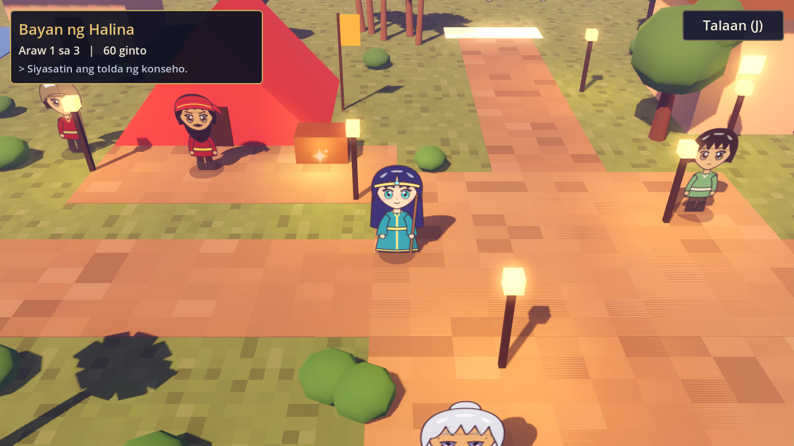
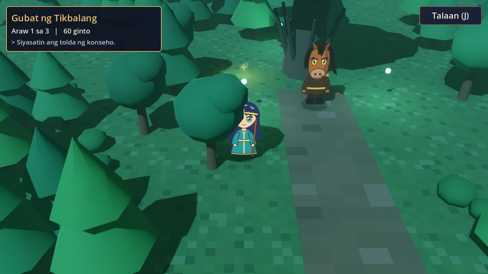
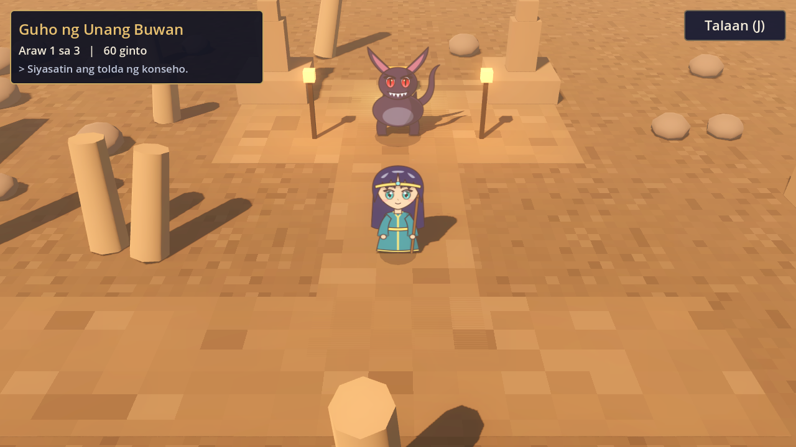
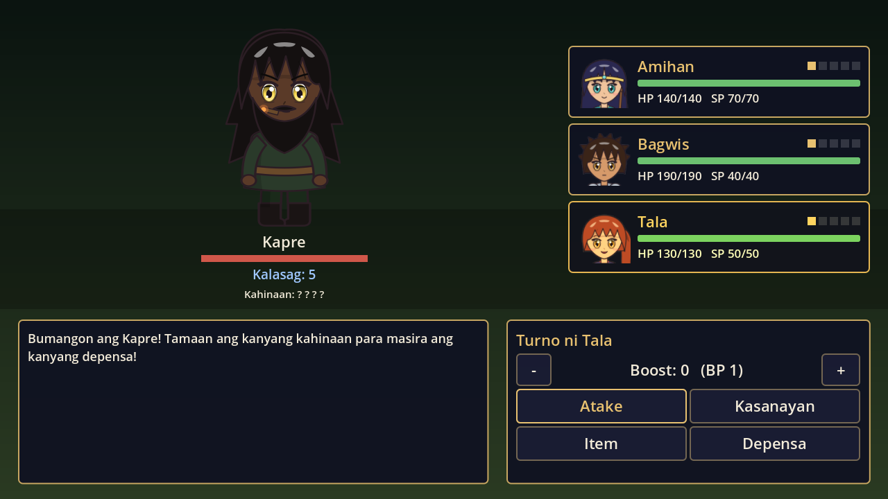
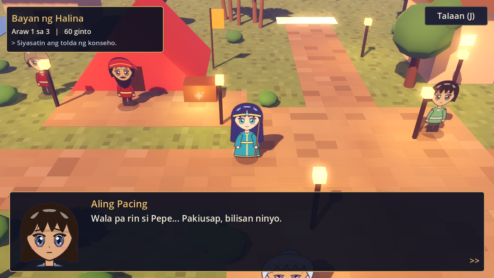
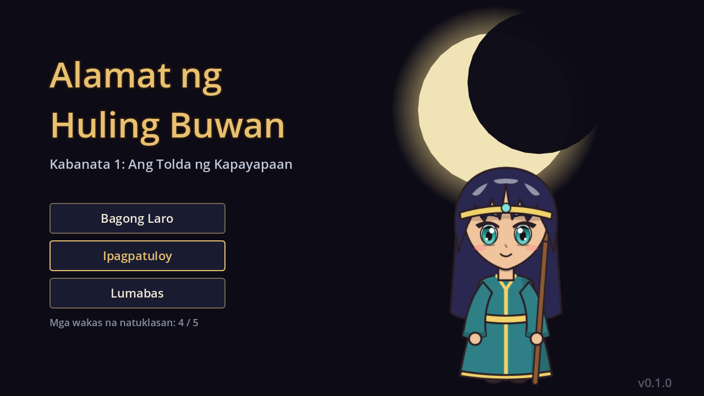
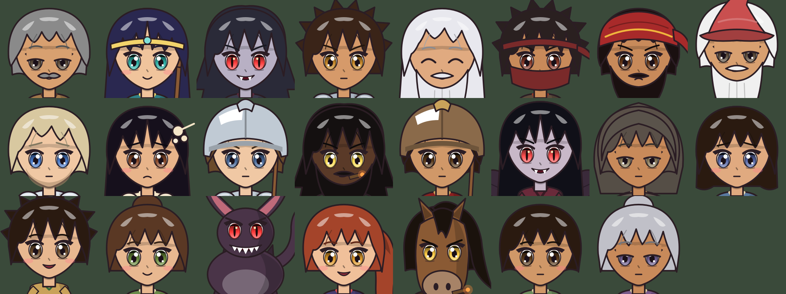

# Alamat ng Huling Buwan

**Kabanata 1: Ang Tolda ng Kapayapaan**

Isang story-driven JRPG para sa **Windows at Android**, gawa sa libreng
[Godot 4](https://godotengine.org). Kwento at desisyon ang bida, hindi ang
mamahaling graphics, pero naka-HD-2D style ito (3D na mundo + anime-style
na mga tauhan, katulad ng Octopath Traveler).

> Tatlong daang taon na mula nang lamunin ng Bakunawa ang anim sa pitong buwan.
> Sa bayan ng Halina, sa hangganan ng dalawang kahariang magkaaway, pinatay ang
> sugo ng kapayapaan sa gabi bago ang pirmahan. May tatlong araw ka para
> hanapin ang salarin bago sumiklab ang digmaan.

| | |
| --- | --- |
|  |  |
|  |  |
|  |  |



## Ano ang meron

| Feature | Detalye |
| --- | --- |
| **Misteryo** | Mangalap ng clues, mag-interrogate ng mga suspek, at ituro ang salarin sa paglilitis |
| **5 ending** | Pinakamaganda, malabo, masama, malungkot, at isang lihim na ending |
| **Branching choices** | Ang mga sagot mo ang nagbabago ng kwento, ng kasama mo, at ng ending |
| **3-day deadline** | Ang pagpapahinga ay nagpapagaling pero kumakain ng oras |
| **Open exploration** | Bayan ng Halina, Gubat ng Tikbalang, Guho ng Unang Buwan. Malaya kang pumunta kahit saan |
| **Octopath-style battle** | Kahinaan → Kalasag → BREAK!, at Boost Points para palakasin ang atake |
| **Party** | Amihan (babaylan), Bagwis (itinapong kabalyero), Tala (magnanakaw, opsyonal) |
| **Side quest** | Iligtas si Pepe mula sa Kapre (may gantimpala, at may clue pa) |
| **Pinoy mythology** | Tikbalang, Kapre, Sigbin, Aswang, Duwende, Manananggal, Bakunawa |
| **Mobile-ready** | Virtual joystick at touch buttons sa Android; keyboard o gamepad sa PC |

## Paano laruin (PC)

| Kilos | Keyboard | Gamepad |
| --- | --- | --- |
| Lumakad | WASD / Arrow keys | Left stick / D-pad |
| Kausapin / Tuloy | E, Space, Enter | A |
| Talaan (clues, layunin, save) | J / Tab | Start |
| Boost +/- (sa labanan) | R / Q | RB / LB |

Sa Android: joystick sa kaliwa, bilog na **Kausapin** button sa kanan, at
**Talaan** button sa itaas.

## Patakbuhin ang project

1. I-download ang [Godot 4.3](https://godotengine.org/download/archive/4.3-stable/) (libre, walang install).
2. Buksan ang Godot → **Import** → piliin ang `project.godot` dito.
3. Pindutin ang **F5** para maglaro.

## Gumawa ng .exe at .apk

### Pinakamadali: GitHub Actions (libre, awtomatiko)

Bawat push sa `main` ay nagpapatakbo ng [`.github/workflows/build.yml`](.github/workflows/build.yml):

1. Chine-check ang story data at nilalaro ang lahat ng ending nang awtomatiko.
2. Gumagawa ng **Windows `.exe`** at **Android `.apk`**.
3. Puntahan ang tab na **Actions** → piliin ang pinakabagong run → i-download sa **Artifacts**.

Kapag nag-push ka ng tag na `v0.1.0` (o kahit anong `v*`), gagawa rin ito ng
GitHub Release na may dalawang file.

> Debug key ang ginagamit ng APK, kaya puwede itong i-install sa sarili mong phone
> (i-allow ang "Install unknown apps"). Para sa Google Play, gumawa ng sariling
> release keystore at **huwag itong i-commit**.

### Sa sarili mong computer

1. Sa Godot: **Editor → Manage Export Templates → Download and Install**.
2. **Windows:** Project → Export → *Windows Desktop* → Export Project.
3. **Android:** I-install ang [Android Studio](https://developer.android.com/studio) (para sa SDK)
   at JDK 17, i-set ang paths sa *Editor Settings → Export → Android*, tapos
   Project → Export → *Android* → Export Project.

## Ayusin o dagdagan ang kwento (walang coding)

Nasa `data/` ang lahat ng content, sa JSON:

| File | Laman |
| --- | --- |
| `data/dialogue/*.json` | Lahat ng usapan, choices, at kondisyon |
| `data/maps/*.json` | Layout ng mapa, NPCs, labasan, random encounters |
| `data/characters.json` | Pangalan ng bawat tauhan |
| `tools/gen_art.py` | Itsura ng bawat tauhan (buhok, mata, damit, kulay, sandata) |
| `data/party.json`, `skills.json` | Stats at kasanayan ng grupo |
| `data/enemies.json`, `encounters.json` | Mga kalaban at labanan |
| `data/clues.json`, `endings.json`, `quests.json` | Clues, endings, side quests |

Halimbawa ng dialogue node:

```json
"lito_wine": {
  "if":   {"clue": "testimonya"},
  "do":   {"set": {"wine_from_shrine": true}, "clue": "tasa", "gold": 10},
  "lines": [["lito", "Galing mismo sa Dambana ng Buwan."]],
  "choices": [
    {"text": "Salamat.", "next": ""},
    {"text": "Simulan ang paglilitis", "next": "trial:start", "if": {"min_day": 2}}
  ]
}
```

- **Kondisyon (`if`)**: `flag`, `not_flag`, `clue`, `not_clue`, `any_clue`, `member`, `not_member`, `gold`, `min_day`, `max_day`
- **Epekto (`do`)**: `set`, `clue`, `gold`, `item`, `join`, `leave`, `heal`, `rest`, `battle`, `ending`
- **`next`**: ibang node sa parehong file, o `file:node` para sa ibang file

Pagkatapos mag-edit, i-check kung may sirang link:

```sh
godot --headless --path . -s tests/validate_data.gd
godot --headless --path . -s tests/playthrough.gd -- --route=best   # best | partial | war | hiraya | late
```

## Tungkol sa graphics (kaya ba ang Octopath level?)

**Ang style, oo. Ang art quality, depende sa assets.**

- Naka-setup na ang HD-2D look: 3D na mundo, billboard na mga tauhan,
  tilt-shift depth of field, bloom, fog, at dynamic lights. Lahat libre sa Godot.
- **Anime-style ang mga tauhan**: malalaking makintab na mata, buhok na may
  kintab, cel shading. Vector art (SVG) ang mga ito na ginawa ng
  `tools/gen_art.py`, kaya malinaw kahit anong laki ng screen.
  - Full body: `art/characters/<id>.svg` (sa mapa at labanan)
  - Bust portrait: `art/portraits/<id>.svg` (sa dialogue)
- **Baguhin ang itsura**: i-edit ang listahang `C` sa `tools/gen_art.py`
  (hal. `hair_style="ponytail"`, `eyes="#2fb3a8"`, `outfit="armor"`,
  `weapon="sword"`), tapos patakbuhin ang `python3 tools/gen_art.py`.
  Silipin lahat: `godot --headless --path . -s tests/art_gallery.gd -- --out=gallery.png`
- **Sariling drawing**: maglagay ng PNG sa `art/characters/<id>.png` at/o
  `art/portraits/<id>.png`. Mas inuuna ang PNG kaysa sa SVG.
  Libreng drawing tools: [Krita](https://krita.org), [Inkscape](https://inkscape.org).
  Libreng art: [itch.io free assets](https://itch.io/game-assets/free),
  [OpenGameArt](https://opengameart.org), [Kenney](https://kenney.nl) (CC0).

## Istruktura

```
project.godot            Godot project (Mobile renderer, landscape)
export_presets.cfg       Windows + Android export settings
scenes/                  title, world, battle, ending
scripts/autoload/        GameState (flags, save), Dialogue (UI), Sprites (character art)
art/                     Anime-style na tauhan (SVG): characters/ at portraits/
tools/gen_art.py         Gumagawa ng art ng mga tauhan
scripts/world/           World builder, HUD/Talaan, touch controls
scripts/battle/          Turn-based battle (Break + Boost)
scripts/ui/              Title at Ending screens
data/                    Lahat ng kwento at game data (JSON)
tests/                   Data validator, automated playthrough, screenshots
```

## Susunod na puwedeng gawin

- Kabanata 2 (paghabol sa Kapatiran ng Bakunawa)
- Musika at sound effects (libre: [freesound.org](https://freesound.org), [OpenGameArt](https://opengameart.org))
- EXP at level-up, mga bagong job/class
- Walking animation at iba't ibang expression ng mukha sa dialogue
- English translation
