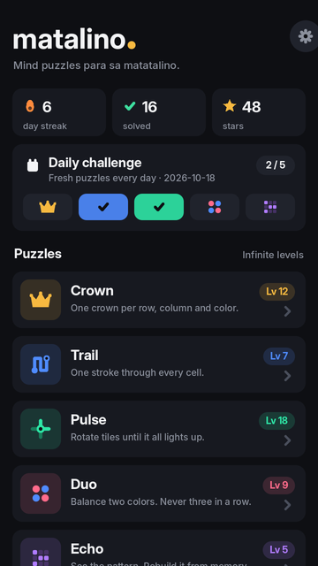
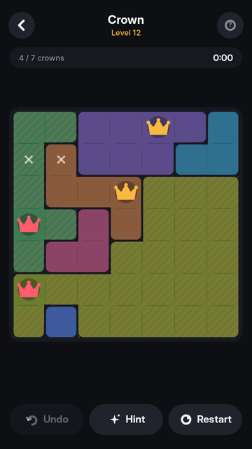
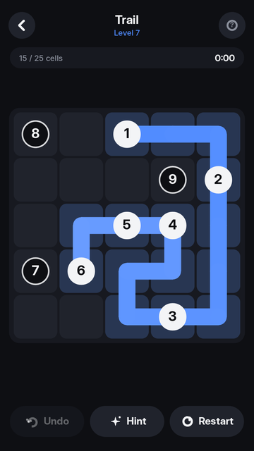
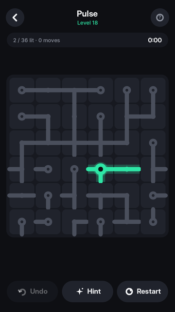
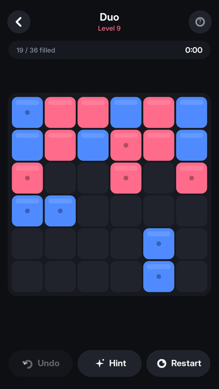
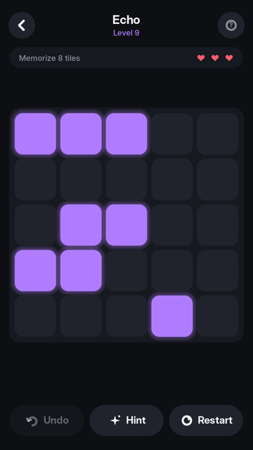
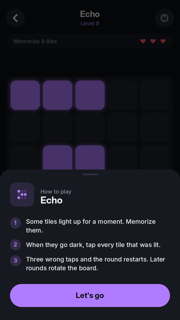
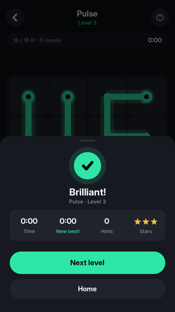

# Matalino

**Limang mind puzzle para sa matatalino.** Minimal, malinis, at nakakaadik na
Android puzzle app, gawa sa [Godot 4.3](https://godotengine.org). Walang ads,
walang internet na kailangan, at walang katapusang levels (lahat ng puzzle ay
ginagawa ng code at sigurado na may sagot).

| | | | |
| --- | --- | --- | --- |
|  |  |  |  |
|  |  |  |  |

## Ang limang laro

| Laro | Utak na ginagamit | Paano |
| --- | --- | --- |
| **Crown** | Logic | Isang korona sa bawat row, column at kulay. Bawal magdikit ang korona, kahit pahilis. |
| **Trail** | Planning | Isang guhit mula 1, dadaan sa mga numero nang sunod-sunod, at pupunuin ang buong grid. |
| **Pulse** | Spatial | I-rotate ang mga tile hanggang umilaw ang buong network. Bawal ang nakalawit na tubo. |
| **Duo** | Logic | Pink at blue. Bawal ang tatlong magkakatabing pareho; pantay ang bilang sa bawat row at column. |
| **Echo** | Memory | Tandaan ang mga umilaw na tile at ulitin. Sa mas mataas na level, umiikot pa ang board. |

Bawat puzzle ay **may iisang tamang sagot** (Crown, Duo) o **siguradong kayang
tapusin** (Trail, Pulse), dahil sinusuri ito ng solver bago ipakita.

## Features

- **Infinite levels** na pahirap nang pahirap (lumalaki ang grid, kumokonti ang clue)
- **Daily challenge**: limang bagong puzzle araw-araw, pareho para sa lahat ng player
- **Streak, stars at best time** bawat level
- **Undo, Hint, Restart**; ang hint ay laging tama at nagtuturo ng susunod na lohikal na hakbang
- **How to play** na lumalabas sa unang laro, at laging mabubuksan sa `?`
- Tunog at vibration (pwedeng patayin sa Settings); lahat ng tunog ay ginagawa ng code
- Dark, minimal na design; lahat ng graphics ay vector na iginuguhit ng code kaya malinaw sa kahit anong screen
- Naka-save ang progress offline

## Paano i-install sa Android

Bawat push na may binago sa `matalino/` ay nagpapatakbo ng
[`.github/workflows/matalino.yml`](../.github/workflows/matalino.yml):

1. Sinusubukan ang lahat ng puzzle generator at nilalaro ang bawat laro gamit ang simulated touch.
2. Gumagawa ng `Matalino.apk`.

I-download ang APK sa **Actions → Matalino (Android) → Artifacts**, o sa release
na **Matalino (latest)** kapag na-merge na sa `main`. Buksan sa phone at i-allow
ang "Install unknown apps".

> Debug-signed ang APK para madaling i-test. Para sa Play Store, gumawa ng sariling
> release keystore at i-export gamit ang `--export-release`.

## Patakbuhin sa PC

1. I-download ang [Godot 4.3](https://godotengine.org/download/archive/4.3-stable/).
2. **Import** → piliin ang `matalino/project.godot` → **F5**.

## Tests

```bash
godot --headless --path matalino res://tests/test_generators.tscn   # 40 levels bawat laro: valid, solvable, unique
godot --headless --path matalino res://tests/test_play.tscn         # nilalaro ang lahat gamit ang touch input
xvfb-run godot --path matalino res://tests/screenshots.tscn -- --out=/tmp/shots
```

## Istruktura

```
matalino/
  scripts/autoload/  ui.gd (design tokens + vector icons), save.gd, sfx.gd
  scripts/games/     board.gd (base) + crown, trail, pulse, duo, echo (generator + solver + drawing)
  scripts/screens/   home.gd, game_screen.gd
  scripts/ui/        btn.gd, sheet.gd, painted.gd
  tools/gen_icons.py launcher icons
```

Font: [Inter](https://rsms.me/inter/) (SIL Open Font License, nasa `assets/fonts/OFL.txt`).
